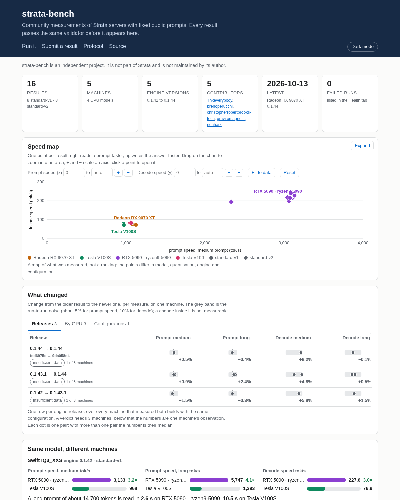

# strata-bench

Community measurements of [Strata](https://github.com/Niko1221/Strata) servers with fixed public prompts, and a health view of the failures people run into.
**Results and dashboard: https://brenoperucchi.github.io/strata-bench/**

<p align="center">
  <a href="https://brenoperucchi.github.io/strata-bench/">
    <picture>
      <source media="(prefers-color-scheme: dark)" srcset="docs/img/dashboard-dark.png">
      
    </picture>
  </a>
</p>

strata-bench is an independent project. It is not part of Strata and is not maintained by its author. MIT licensed.

## What you get

- A runner that measures a Strata server you already run and writes one `result.json` (schema `strata-bench/v1`, or `strata-bench/v2` with `--protocol standard-v2`) per configuration.
- A validator that is the public-export gate: it accepts only results of the public protocol and refuses anything that looks like a local path, a private address or a secret.
- A dashboard under a summary strip, in three tabs: Dashboard, Results and Health. The Dashboard tab opens with a full-width speed map (one point per result; drag on the chart to zoom into an area, use + and − to scale an axis, type a range or fit it to the data, and Expand opens it over the page), a "What changed" panel with three tabs (Releases: one row per engine release over every machine, By GPU: each machine's comparisons in compact rows, Configurations: the arguments that differ), drawn against the run-to-run noise band, and the same model on different machines. The panel keeps its height as results grow: groups fold and long lists stop at five rows. It says "insufficient data" instead of a verdict until three machines back a release, and a pair where the build and the configuration changed together is shown but flagged, since it does not say which one moved the numbers. A legacy result that has only the short prompts (`gprobe`) has no medium or long speed, so it is compared by the time to read the prompt, where a drop is the improvement, in its own table. The Results tab lists every result with prompt and decode speeds side by side for the same model and config; a link with a filter (`?by=name`) opens on it. Tick two or three results and Compare opens them side by side, with a scoreboard of who is in front on more measures: only measures present in every selected result count, a lead inside the run-to-run noise band is a tie, and it says in words that this counts measures and does not show one setup is better overall or why. The Health tab lists the catastrophic failures that runs recorded: crash, out of memory, degenerate output, hang, server error.

## Run it

You need Python 3.10 or newer (standard library only) and a running Strata server.

```
python3 -m strata_bench run --base http://127.0.0.1:18299 --config strata-yourmodel.json \
    --origin setup-default --label myrig-0142-default --out results/ --identity my-identity.json
python3 -m strata_bench validate results/*.result.json
```

Add `--protocol standard-v2` to also measure the time to the first token, a five-turn agent session with the prompt cache on, and 2, 4 and 8 clients at once (`--suite quick`, `standard` or `full`). The guide has the details.

Then send the file with the [upload page](https://brenoperucchi.github.io/strata-bench/submit.html), a pull request that adds it under `results/`, or a "Submit a result" issue. The step-by-step guide, with the identity file and what each status means, is in [docs/SUBMIT.md](docs/SUBMIT.md). What exactly is sent and recorded is in [docs/PROTOCOL.md](docs/PROTOCOL.md).

## How it behaves

- Attach mode: you start and stop the server. The runner refuses to measure (exit 2) if the server's model file or context differs from the config's, if a prompt file was modified, or if the result file already exists. It never overwrites a result.
- It saves after every call. A run that stops early keeps what it measured: exit 3, with status `failed` when the server failed (crash, out of memory, degenerate output, hang, 5xx) or `incomplete` for anything else, such as Ctrl+C. Only `ok`, `warnings` and `failed` results can be published.
- `--origin` is `setup-default` (the config the release's setup writes) or `custom-N`. The config's `args` and `env` are stored with paths replaced by roles (`<pack>`, `<native>`, ...) and hashed into `config_id`.
- Nobody picks sizes. `standard-v1` always measures `probe`, `medium`, `long` and `xlong`; `standard-v2` runs one of the suites `quick`, `standard` or `full`. Results are only comparable when everybody measured the same things, so the validator, CI, the upload page and the Worker reject a result whose sizes are not exactly those of its profile. A closed list of results published before this rule (`validate.LEGACY`) keeps its place and is marked legacy; it never grows.
- Protocol `standard-v1`: prompts in `strata_bench/prompts` (hashes in `SHA256SUMS`), temperature 0, seed 42, 256-token cap, 1 warm-up and 3 measured runs, a constant first line per (size, run). The probes use a fixed system prompt and 30 one-token calls, the first 2 skipped.
- Protocol `standard-v2` (`--protocol standard-v2`): the same texts, streamed, plus the time to the first token, a short chat, a five-turn agent session with the prompt cache, and several clients at once, in the suites `quick`, `standard` and `full`. The two protocols are described in [docs/PROTOCOL.md](docs/PROTOCOL.md); v1 stays the default.
- `gprobe` (part of the `full` suite of `standard-v2`): 30 calls at each of about 150, 300 and 450 tokens shaped like an agent's classifier request. It measures the prompt path below Strata's 1024-token streamed walk, which the line probes barely touch. Results go to `sizes.gprobe150/300/450`.
- The top level keeps flat `label`, `build_info`, `model_path` (file name only) and `n_ctx`, and `sizes{}` keeps the `prompt_tps`, `decode_tps` and `prompt_ms` medians that existing dashboards read.

## Develop

```
python3 -m unittest discover -s tests
python3 tools/build_site.py          # rebuild docs/data.json from results/ (CI does this after each merge)
```

The page in `docs/` is static: plain HTML, CSS and JavaScript reading `docs/data.json`, served by GitHub Pages from `main` and `/docs`.

The prompts are excerpts of the Strata source (https://github.com/Niko1221/Strata, MIT); see `strata_bench/prompts/README.md` for how each one was cut.
